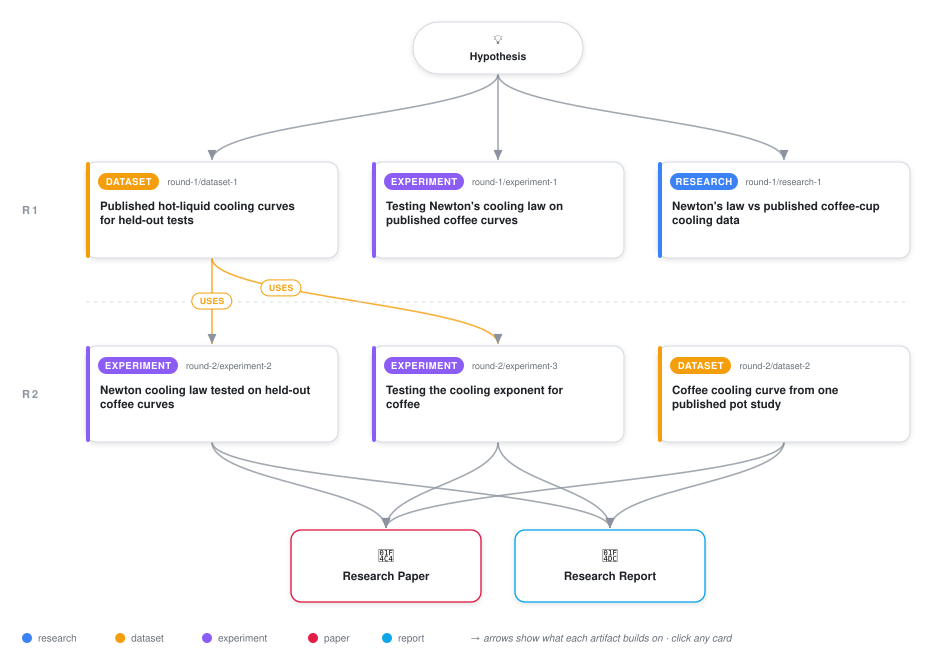

# Newton's Cooling Law Fitted to One Coffee Curve Does Not Transfer Between Cups

<div align="center">

<a href="https://cdn.jsdelivr.net/gh/ai-inventor-papers/ai-invention-5821c4-newtons-cooling-law-for-coffee-over-30@main/workflow.svg">
<picture>
  <source media="(prefers-color-scheme: dark)" srcset="workflow-dark.svg">
  
</picture>
</a>

<sub>🖱️ <b><a href="https://cdn.jsdelivr.net/gh/ai-inventor-papers/ai-invention-5821c4-newtons-cooling-law-for-coffee-over-30@main/workflow.svg">Open the interactive diagram</a></b> — every card links to its artifact folder.</sub>

</div>

> **TL;DR** — We fitted Newton's law of cooling and a one-term power-law extension to the first 30 minutes of one measured coffee curve, froze the constants, and evaluated them on seven held-out curves (one coffee cup and six 237 mL hot-water cups). The accuracy target registered in advance of 0.5 K failed: Newton's law has a mean 30-minute RMS error of 8.3 K (95% interval 6.5 to 9.9 K). The power-law extension is 0.19 K lower on the mean (paired 95% interval -0.44 to -0.00 K), but a resampling test gives p = 0.06 and the advantage reverses when the Manitoba coffee cup is held out, so that gap is not established. The constant transfers poorly between cups unless fitted again: fitting again to the first 10 minutes gives 0.64 K over eleven curves, but the coffee cup stays at 5.3 K.

<details>
<summary>Full hypothesis</summary>

For an open cup of hot coffee, constant-rate Newton's law of cooling, T(t) = T_room + (T_0 - T_room) exp(-k t), misses the first 30 minutes. In the one published china-pot curve (Sedlacek and Dolejsi), its 30-minute in-sample RMS error is 1.07 K (95% block-bootstrap interval 0.60-1.53 K) with room temperature fixed at 20 C. Freeing room temperature gives 0.54 K, so the size of the misfit depends on that assumption. The early residual is positive (underprediction of heat loss, +0.62 K over 0-10 min). A one-term nonlinear convection law, dT/dt = -a (T - T_room)^x / C, lowers the in-sample error to 0.36 K, but its exponent x ranges from 1.50 to 1.94 across windows and ambient choices, so it is a lead, not an established model. The claim to be tested: on eight published curves not used for fitting (Manitoba coffee and Langer hot water), the nonlinear law's 30-minute RMS error is under 0.5 K and lower than Newton's law's on the same curves, with Newton's error reported under its stated room temperature. The evaporative and humidity terms are not established: the two-term evaporative form was not identifiable from one curve, and no source records humidity with cooling curves.

</details>

[](https://ai-inventor-papers.github.io/ai-invention-5821c4-newtons-cooling-law-for-coffee-over-30/) [](https://ai-inventor-papers.github.io/ai-invention-5821c4-newtons-cooling-law-for-coffee-over-30/interactive.html)

[](https://cdn.jsdelivr.net/gh/ai-inventor-papers/ai-invention-5821c4-newtons-cooling-law-for-coffee-over-30@main/paper.pdf) [](https://cdn.jsdelivr.net/gh/ai-inventor-papers/ai-invention-5821c4-newtons-cooling-law-for-coffee-over-30@main/report.pdf) [](https://cdn.jsdelivr.net/gh/ai-inventor-papers/ai-invention-5821c4-newtons-cooling-law-for-coffee-over-30@main/exec_summary.pdf) [](https://cdn.jsdelivr.net/gh/ai-inventor-papers/ai-invention-5821c4-newtons-cooling-law-for-coffee-over-30@main/round-2/report.pdf) [](https://github.com/ai-inventor-papers/ai-invention-5821c4-newtons-cooling-law-for-coffee-over-30/tree/main/paper_latex)

**Round reports:** [Round 1](https://cdn.jsdelivr.net/gh/ai-inventor-papers/ai-invention-5821c4-newtons-cooling-law-for-coffee-over-30@main/round-1/report.pdf) · [Round 2](https://cdn.jsdelivr.net/gh/ai-inventor-papers/ai-invention-5821c4-newtons-cooling-law-for-coffee-over-30@main/round-2/report.pdf)

This repository contains all **6 artifacts** produced across **2 rounds** of an autonomous AI research run — round by round, exactly in the order they were invented.

## Round 1

| Artifact | Type | Demo | Source | Builds on |
|----------|------|------|--------|-----------|
| **[Published hot-liquid cooling curves for held-out tests](https://github.com/ai-inventor-papers/ai-invention-5821c4-newtons-cooling-law-for-coffee-over-30/tree/main/round-1/dataset-1)** | [](https://github.com/ai-inventor-papers/ai-invention-5821c4-newtons-cooling-law-for-coffee-over-30/tree/main/round-1/dataset-1) | — | [](https://github.com/ai-inventor-papers/ai-invention-5821c4-newtons-cooling-law-for-coffee-over-30/tree/main/round-1/dataset-1/src) | — |
| **[Testing Newton's cooling law on published coffee curves](https://github.com/ai-inventor-papers/ai-invention-5821c4-newtons-cooling-law-for-coffee-over-30/tree/main/round-1/experiment-1)** | [](https://github.com/ai-inventor-papers/ai-invention-5821c4-newtons-cooling-law-for-coffee-over-30/tree/main/round-1/experiment-1) | — | [](https://github.com/ai-inventor-papers/ai-invention-5821c4-newtons-cooling-law-for-coffee-over-30/tree/main/round-1/experiment-1/src) | — |
| **[Newton's law vs published coffee-cup cooling data](https://github.com/ai-inventor-papers/ai-invention-5821c4-newtons-cooling-law-for-coffee-over-30/tree/main/round-1/research-1)** | [](https://github.com/ai-inventor-papers/ai-invention-5821c4-newtons-cooling-law-for-coffee-over-30/tree/main/round-1/research-1) | [](https://github.com/ai-inventor-papers/ai-invention-5821c4-newtons-cooling-law-for-coffee-over-30/blob/main/round-1/research-1/demo/research_demo.md) | [](https://github.com/ai-inventor-papers/ai-invention-5821c4-newtons-cooling-law-for-coffee-over-30/tree/main/round-1/research-1/src) | — |

## Round 2

| Artifact | Type | Demo | Source | Builds on |
|----------|------|------|--------|-----------|
| **[Newton cooling law tested on held-out coffee curves](https://github.com/ai-inventor-papers/ai-invention-5821c4-newtons-cooling-law-for-coffee-over-30/tree/main/round-2/experiment-2)** | [](https://github.com/ai-inventor-papers/ai-invention-5821c4-newtons-cooling-law-for-coffee-over-30/tree/main/round-2/experiment-2) | — | [](https://github.com/ai-inventor-papers/ai-invention-5821c4-newtons-cooling-law-for-coffee-over-30/tree/main/round-2/experiment-2/src) | <sub><i>uses:</i><br/>[dataset‑1&nbsp;(R1)](https://github.com/ai-inventor-papers/ai-invention-5821c4-newtons-cooling-law-for-coffee-over-30/tree/main/round-1/dataset-1)</sub> |
| **[Testing the cooling exponent for coffee](https://github.com/ai-inventor-papers/ai-invention-5821c4-newtons-cooling-law-for-coffee-over-30/tree/main/round-2/experiment-3)** | [](https://github.com/ai-inventor-papers/ai-invention-5821c4-newtons-cooling-law-for-coffee-over-30/tree/main/round-2/experiment-3) | — | [](https://github.com/ai-inventor-papers/ai-invention-5821c4-newtons-cooling-law-for-coffee-over-30/tree/main/round-2/experiment-3/src) | <sub><i>uses:</i><br/>[dataset‑1&nbsp;(R1)](https://github.com/ai-inventor-papers/ai-invention-5821c4-newtons-cooling-law-for-coffee-over-30/tree/main/round-1/dataset-1)</sub> |
| **[Coffee cooling curve from one published pot study](https://github.com/ai-inventor-papers/ai-invention-5821c4-newtons-cooling-law-for-coffee-over-30/tree/main/round-2/dataset-2)** | [](https://github.com/ai-inventor-papers/ai-invention-5821c4-newtons-cooling-law-for-coffee-over-30/tree/main/round-2/dataset-2) | — | [](https://github.com/ai-inventor-papers/ai-invention-5821c4-newtons-cooling-law-for-coffee-over-30/tree/main/round-2/dataset-2/src) | — |

## Repository Structure

Artifacts are grouped by the round of invention that produced them. Each
artifact has its own folder with source code and a self-contained demo:

```
.
├── round-1/                         # One folder per round of invention
│   ├── experiment-1/
│   │   ├── README.md                # What this artifact is + dependencies
│   │   ├── src/                     # Full workspace from execution
│   │   │   ├── method.py            # Main implementation
│   │   │   ├── method_out.json      # Full output data
│   │   │   └── ...                  # All execution artifacts
│   │   └── demo/                    # Self-contained demo
│   │       └── method_code_demo.ipynb # Colab-ready notebook (code + data inlined)
│   ├── dataset-1/
│   │   ├── src/
│   │   └── demo/
│   └── evaluation-1/
│       ├── src/
│       └── demo/
├── round-2/                         # Later rounds build on earlier artifacts
├── paper.pdf                        # Research paper
├── paper_latex/                     # LaTeX source files
├── report.pdf                       # Full internal report — every experiment, table and dead end
├── report_latex/                    # LaTeX source of the report
├── exec_summary.pdf                 # Executive summary of the report, at most four pages
├── chat/                            # Every prompt, response and tool call, per module
├── workflow.svg                     # Artifact dependency diagram (this page's header)
└── README.md
```

## Running Notebooks

### Option 1: Google Colab (Recommended)

Click the "Open in Colab" badges above to run notebooks directly in your browser.
No installation required!

### Option 2: Local Jupyter

```bash
# Clone the repo
git clone https://github.com/ai-inventor-papers/ai-invention-5821c4-newtons-cooling-law-for-coffee-over-30
cd ai-invention-5821c4-newtons-cooling-law-for-coffee-over-30

# Install dependencies
pip install jupyter

# Run any artifact's demo notebook
jupyter notebook <artifact_folder>/demo/
```

## Source Code

The original source files are in each artifact's `src/` folder.
These files may have external dependencies - use the demo notebooks for a self-contained experience.

---
*Generated by AI Inventor Pipeline - Automated Research Generation*
